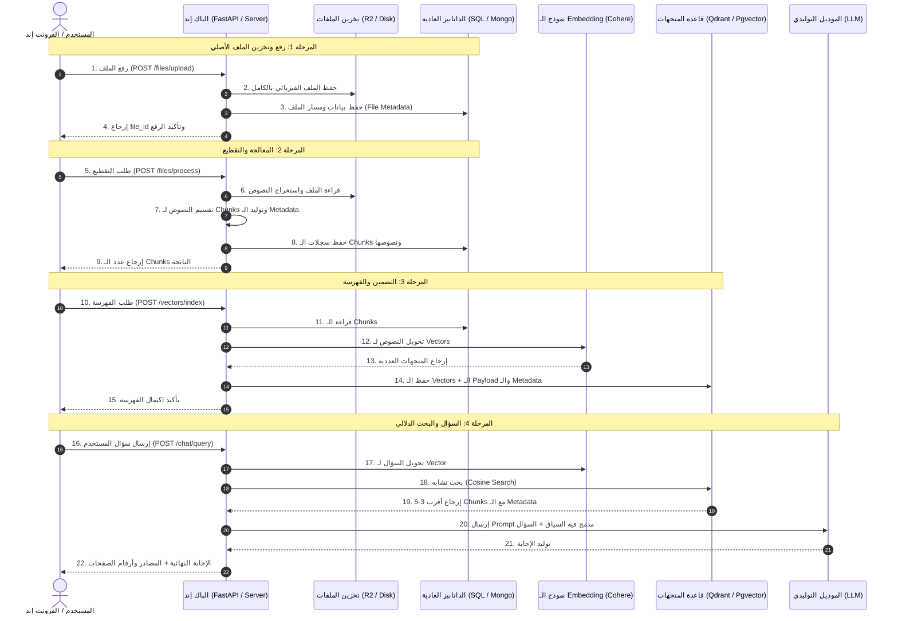

# دليل معمارية وتكامل الـ RAG في الـ Production 🚀
### (دليل تقني مفصل موجه لـ تيم الباك إند - Backend Team)

---

## 🎯 مقدمة وهدف الدليل
الهدف من الدليل ده هو توضيح دورة حياة الملف من أول ما المستخدم يرفعه، مروراً بعملية معالجته وتقطيعه (Chunking)، وتوليد الفيكتورز، لحد ما نسأل الموديل ويجاوب بناءً على الملفات. 

تم تصميم المعمارية دي علشان تضمن:
1. **أعلى Performance وأقل زمن استجابة (Latency).**
2. **أقل تكلفة تشغيلية (Cost-effective)** ومناسبة جداً لمشروع تخرج جاهز للـ Production.
3. **فصل واضح للمسؤوليات (Separation of Concerns):** الملفات لوحدها، البيانات العادية لوحدها، والمتجهات لوحدها.

---

## 1. توضيح مهم جداً لاختيار قاعدة البيانات (SQL Server vs PostgreSQL)

* **لو التيم هيشتغل بـ `PostgreSQL`:**
  * نقدر نفعل إضافة اسمها **`pgvector`** جوه نفس الداتابيز.
  * **الميزة:** قاعدة بيانات واحدة فقط هتشيل بيانات النظام العادية + المتجهات (Vectors) للبحث الدلالي. ده أوفر حل وأسهل حل في الـ Deployment ومش هيحتاج سيرفر إضافي.
* **لو التيم شغال ومستقر على `Microsoft SQL Server`:**
  * الـ SQL Server هيشيل البيانات العادية وسجلات الملفات والقطع.
  * هنستخدم معاه **`Qdrant`** كـ Vector Database منفصلة (سواء Docker container على السيرفر أو Cluster مجاني من Qdrant Cloud بيدي 1GB مجاناً).

---

## 2. أين يتم تخزين الملف الفعلي في الـ Production؟

> [!CAUTION]
> **ممنوع تماماً تخزين محتوى الملفات كـ (BLOB / Binary) داخل الداتابيز!**  
> تخزين الملفات جوه الداتابيز بيعمل تضخم في المساحة (Database Bloat)، ويبطئ الـ Query Performance، ويصعب الـ Backup.

### الخيارات العملية لتخزين الملفات:
1. **Cloudflare R2 (الخيار الموصى به عالمياً - مجاني 100%):**
   * متوافق بالكامل مع S3 API (يعني هتتعامل معاه بمكتبة `boto3` في بايثون أو أي S3 client).
   * بيدي **10 جيجا بايت تخزين مجاني شهرياً**.
   * **صفر تكلفة على الباندويث ($0 Egress Fees)** مهما المستخدمين حملوا أو قرأوا ملفات.
2. **Local Disk / Persistent Volume:**
   * تخزين الملفات على قرص السيرفر نفسه في مجلد مخصص (مثل `/app/storage/uploads/`).
   * لو شغالين بـ Docker لازم المجلد ده يتعمله `Volume` ثابت عشان الداتا متضيعش لو الحاوية اتعملها Restart.

---

## 3. التقطيع (Chunking) وشكل الـ Metadata بالتفصيل الممل

### أ. كيفية التقطيع:
الملف الأصلي بيتقرأ عن طريق مكتبات معالجة المستندات (مثل `PyMuPDF` لملفات الـ PDF). بعدها بيتقسم لقطع صغيرة باستخدام `RecursiveCharacterTextSplitter`:
* **حجم القطعة (`chunk_size`):** من `500` إلى `1000` حرف (Characters / Tokens).
* **التداخل (`chunk_overlap`):** من `50` إلى `100` حرف (عشان نضمن استمرار سياق الجمل بين القطع ومفيش فكرة تتقطع).

---

### ب. شكل وتفاصيل الـ Metadata (أهم جزء للباك إند)

الـ Metadata دي هي بطاقة الهوية لكل ملف ولكل قطعة، وبنحتاجها عشان لما الـ LLM يجاوب يقولنا: **"المعلومة دي موجودة في صفحة كذا في ملف كذا"** (Citations / Sources).

#### 1. ميتاداتا الملف (File Metadata)
بتتسجل عند رفع الملف في جدول الملفات في الداتابيز العادية:
```json
{
  "file_id": "file_8f2a1b9c_3d4e",
  "original_name": "Operating_Systems_Lecture_1.pdf",
  "storage_path": "https://pub-r2.yourdomain.com/uploads/file_8f2a1b9c_3d4e.pdf",
  "file_size_bytes": 2457600,
  "mime_type": "application/pdf",
  "total_pages": 42,
  "uploaded_at": "2026-11-04T12:00:00Z"
}
```

#### 2. ميتاداتا القطعة النصية (Chunk Metadata)
بعد التقطيع، كل قطعة بيكون معاها Metadata دقيقة جداً:
```json
{
  "chunk_id": "chk_001_a9f8",
  "file_id": "file_8f2a1b9c_3d4e",
  "chunk_order": 1,
  "page_number": 3,
  "character_count": 780,
  "token_count": 185,
  "source_document": "Operating_Systems_Lecture_1.pdf",
  "section_title": "Memory Management"
}
```

#### 3. كيف تُخزن في الـ Vector Database (Qdrant أو Pgvector Payload)
في الـ Vector DB، بنخزن الـ Vector (المصفوفة الرقمية الناتجة من الـ Embedding) ومعاها الـ Metadata دي كـ **Payload**:
```json
{
  "id": "chk_001_a9f8",
  "vector": [0.0245, -0.0189, 0.0821, "... 384 dimensions ..."],
  "payload": {
    "file_id": "file_8f2a1b9c_3d4e",
    "file_name": "Operating_Systems_Lecture_1.pdf",
    "page_number": 3,
    "chunk_order": 1,
    "text": "Virtual memory is a memory management capability of an OS that uses hardware and software to allow a computer to compensate for physical memory shortages..."
  }
}
```

---

## 4. الفلو المعماري الكامل (End-to-End Workflow)



---

## 5. مواصفات الـ APIs التفصيلية (API Contracts)

### API 1: رفع الملف (`Upload File`)
* **Endpoint:** `POST /api/v1/files/upload`
* **Content-Type:** `multipart/form-data`
* **Request Body:**
  * `file`: (Binary File - PDF, TXT)

* **Response (`201 Created`):**
```json
{
  "status": "success",
  "message": "File uploaded successfully",
  "data": {
    "file_id": "file_8f2a1b9c_3d4e",
    "original_name": "Operating_Systems_Lecture_1.pdf",
    "file_size": 2457600,
    "mime_type": "application/pdf",
    "storage_url": "https://pub-r2.yourdomain.com/uploads/file_8f2a1b9c_3d4e.pdf",
    "uploaded_at": "2026-11-04T12:00:00Z"
  }
}
```

---

### API 2: معالجة وتقطيع الملف (`Process & Chunk File`)
* **Endpoint:** `POST /api/v1/files/process`
* **Content-Type:** `application/json`
* **Request Body:**
```json
{
  "file_id": "file_8f2a1b9c_3d4e",
  "chunk_size": 800,
  "overlap_size": 80
}
```

* **Response (`200 OK`):**
```json
{
  "status": "success",
  "message": "File processed and text chunks generated successfully",
  "data": {
    "file_id": "file_8f2a1b9c_3d4e",
    "total_chunks": 35,
    "average_chunk_characters": 760
  }
}
```

---

### API 3: تحويل النصوص لمتجهات وفهرستها (`Index Vectors`)
* **Endpoint:** `POST /api/v1/vectors/index`
* **Content-Type:** `application/json`
* **Request Body:**
```json
{
  "file_id": "file_8f2a1b9c_3d4e",
  "batch_size": 50,
  "do_reset": false
}
```

* **Response (`200 OK`):**
```json
{
  "status": "success",
  "message": "Chunks successfully converted to vectors and indexed",
  "data": {
    "file_id": "file_8f2a1b9c_3d4e",
    "indexed_vectors_count": 35,
    "vector_dimensions": 384
  }
}
```

---

### API 4: الاستعلام وتوليد الإجابة (`RAG Query & Chat`)
* **Endpoint:** `POST /api/v1/chat/query`
* **Content-Type:** `application/json`
* **Request Body:**
```json
{
  "query": "ما هو الـ Virtual Memory وكيف يعمل؟",
  "top_k": 3
}
```

* **Response (`200 OK`):**
```json
{
  "status": "success",
  "data": {
    "query": "ما هو الـ Virtual Memory وكيف يعمل؟",
    "answer": "الـ Virtual Memory هي تقنية لإدارة الذاكرة في أنظمة التشغيل، تتيح للجهاز تعويض النقص في الذاكرة العشوائية (RAM) عن طريق استعارة مساحة مؤقتة من القرص الصلب...",
    "sources": [
      {
        "file_name": "Operating_Systems_Lecture_1.pdf",
        "page_number": 3,
        "chunk_order": 1,
        "similarity_score": 0.892,
        "snippet": "Virtual memory is a memory management capability of an OS that uses hardware and software to compensate for physical memory shortages..."
      },
      {
        "file_name": "Operating_Systems_Lecture_1.pdf",
        "page_number": 4,
        "chunk_order": 2,
        "similarity_score": 0.835,
        "snippet": "Paging is a memory management scheme that eliminates the need for contiguous allocation of physical memory..."
      }
    ]
  }
}
```

---

## 6. نصائح أداء للباك إند (Backend Optimization Tips)

1. **الـ Batching في الـ Embedding:**
   * بلاش تبعت الـ Chunks واحد ورا التاني لموديل الـ Embedding.
   * ابعتهم في دُفعات (Batches) من 20 لـ 50 قطعة في الـ Request الواحد، ده هيوفر في وقت الـ Network Latency بشكل هائل.
2. **استخدام Async / Background Tasks:**
   * عمليتي الـ `process` والـ `index` لملفات كبيرة (100 صفحة مثلاً) ممكن تاخد كذا ثانية. الأفضل في الـ Production إن الـ API يرد بـ `202 Accepted` ويشغل المعالجة في Background Task (مثل Celery أو FastAPI BackgroundTasks) عشان الفرونت ميفضلش معلق.
3. **Payload Indexing في Qdrant / Pgvector:**
   * اعمل Index على حقل `file_id` جوه الـ Vector DB، بحيث لو حبيت في المستقبل تمسح كل متجهات ملف معين أو تبحث جوه ملف محدد، الفلترة تكون فورية بدون فحص كل المتجهات (Full Scan).
